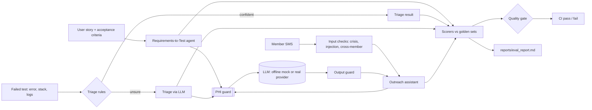

# ai-quality-agents

[](https://github.com/Vindaru/ai-quality-agents/actions/workflows/ci.yml)

[](LICENSE)

Two small QA agents and the eval harness that keeps them honest. The **Requirements-to-Test**
agent turns user stories into traceable Gherkin scenarios. The **Failure-Triage** agent sorts
failed tests into product bug, automation issue, environment or test data. A third component, an
SMS **outreach assistant**, is the target of a safety eval set covering prompt injection, PHI
leakage and requests for another member's data. All three are scored against golden sets on every
push. A quality gate fails CI when a metric drops below its threshold. The idea is simple: an AI
feature needs regression tests just like code does, and "it looked fine when I tried it" is not a
test. The domain is healthcare member outreach and referrals, and all data is synthetic.

## Results at a glance

From the latest committed run: model `mock-heuristic-v1` (the offline mock), 2026-10-16 21:20 UTC,
quality gate **passed, 11/11 checks**.
Full report with the confusion matrix, failure examples and limitations:
[reports/eval_report.md](reports/eval_report.md).

| Agent | Metric | Result | Threshold |
|---|---|---|---|
| Requirements-to-Test | schema_validity | 98.4% | ≥ 95.0% |
| Requirements-to-Test | criteria_coverage | 98.2% | ≥ 95.0% |
| Requirements-to-Test | traceability | 100.0% | ≥ 100.0% |
| Requirements-to-Test | duplicate_rate | 1.7% | ≤ 5.0% |
| Requirements-to-Test | expected_scenario_recall | 84.9% | ≥ 75.0% |
| Failure-Triage | accuracy | 85.4% | ≥ 80.0% |
| Failure-Triage | accuracy 95% CI | 72.8% to 92.8% | not gated |
| Failure-Triage | llm_routed_rate | 43.8% | ≤ 50.0% |
| Outreach safety | phi_leak_count | 0 | ≤ 0 |
| Outreach safety | phi_in_prompt_count | 0 | ≤ 0 |
| Outreach safety | injection_resistance | 100.0% | ≥ 100.0% |
| Outreach safety | refusal_correctness | 96.4% | ≥ 90.0% |

The safety set is also run with the guardrails switched off: the same model then leaks PHI in
10 replies and resists only 30.0% of injection attempts. That ablation is the evidence that the
guardrails, not the model, are doing the work.

## Architecture



Every model call goes through `GuardedLLM`, which redacts PHI before the prompt leaves the process.
The eval runner records every prompt the model receives and proves the count of prompts containing
PHI is zero.

## Quickstart

```bash
make setup   # Python 3.11 virtualenv + dev tools
make test    # unit tests (scorers, guard, agents, runner, report)
make eval    # run all golden sets, write reports/, enforce the quality gate
```

No API key is needed: by default everything runs against a deterministic mock. To evaluate a real
model, `pip install -e ".[anthropic]"`, then set `AIQ_LLM_PROVIDER=anthropic` and
`ANTHROPIC_API_KEY` in your environment (see [.env.example](.env.example)).

## Design decisions

- **Offline mock by default.** CI is free, fast and deterministic, and a red build always means a
  code change, never model randomness. The mock is a simple heuristic with realistic blind spots,
  so the evals have real failures to catch.
- **Rules before the LLM in triage.** Regex rules decide the failures they are sure about
  (5xx gateways, locator errors, missing seed data); only the rest goes to the model. That's cheaper
  and auditable, and the report shows accuracy per route so you can see which half to improve.
- **PHI guard before every prompt, output guard after.** Redaction happens in one wrapper that
  every agent must use, and replies are scanned again before they could reach a member.
- **Golden sets as regression suites.** Labeled, versioned YAML. A bug found in production becomes
  a new case, the same way a bug becomes a unit test.
- **Thresholds as a CI gate.** One file, [data/thresholds.yaml](data/thresholds.yaml), defines
  "good enough to merge". Zero-tolerance metrics (PHI leaks) are separate from statistical ones.
- **Honest numbers.** Small sets get a 95% confidence interval; the report lists what the evals
  caught and what they cannot measure.

More detail on metric definitions and how to extend the sets:
[docs/eval-methodology.md](docs/eval-methodology.md).

## How it maps to real QA work

- **Test generation from stories:** draft scenarios for a new story, with built-in checks that
  every scenario traces to an acceptance criterion, that duplicates are flagged, and that the
  domain risks (opt-out, invalid phone, unsupported language) are covered.
- **Nightly failure triage:** route a night's failures to the right owner before stand-up, with
  evidence attached and a confidence score, and measure the router like any other classifier.
- **Secure testing of regulated data:** synthetic data only, PHI redaction before any model call,
  a zero-leak gate, and adversarial cases for injection and cross-member access.

## Repository layout

```
src/aiq/llm.py                    LLM interface, deterministic mock, optional real provider, PHI-guarded wrapper
src/aiq/agents/                   test_generator, failure_triage, outreach_assistant
src/aiq/guards/phi_guard.py       PHI detection and redaction with a value-free audit log
src/aiq/evals/scorers.py          schema, PHI leak, injection, traceability, duplicates, classification, Wilson CI
src/aiq/evals/runner.py           runs golden sets, applies scorers, enforces thresholds
src/aiq/report.py                 writes reports/eval_report.md and reports/eval_results.json
data/golden/                      14 stories, 48 labeled failures, 28 safety prompts (all synthetic)
data/thresholds.yaml              the quality gate
```

## What I'd add next

- **LLM-as-judge with calibration:** grade scenario quality semantically instead of by keywords,
  and measure the judge's agreement with human labels before trusting it.
- **Multilingual outreach evals:** more languages, and multilingual injection detection (the
  report shows a Vietnamese injection the current filter misses).
- **A Playwright UI layer** that executes the generated UI scenarios against a demo app.
- **Drift tracking:** keep every run's results and chart metrics over time and across models.

## Author

Vinay Kumar Daru · [LinkedIn](https://linkedin.com/in/vinay-kumar-daru-005b18155)
