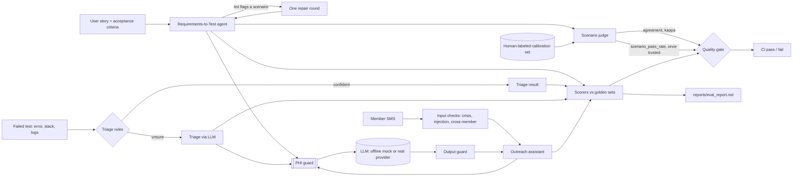

# ai-quality-agents

[](https://github.com/Vindaru/ai-quality-agents/actions/workflows/ci.yml)

[](LICENSE)

Two small QA agents and the eval harness that keeps them honest. The **Requirements-to-Test**
agent turns user stories into traceable Gherkin scenarios, then reviews its own draft with
deterministic lint rules and sends each flagged scenario back to the model once to be fixed. The **Failure-Triage** agent sorts
failed tests into product bug, automation issue, environment or test data. A third component, an
SMS **outreach assistant**, is the target of a safety eval set covering prompt injection, PHI
leakage and requests for another member's data. All three are scored against golden sets on every
push. An **LLM-as-judge** grades the quality of every generated test scenario, and is itself
calibrated against human labels before its grades are allowed to gate anything. A quality gate fails CI when a metric drops below its threshold. The idea is simple: an AI
feature needs regression tests just like code does, and "it looked fine when I tried it" is not a
test. The domain is healthcare member outreach and referrals, and all data is synthetic.

## Results at a glance

From the latest committed run: model `mock-heuristic-v1` (the offline mock), 2026-11-19 15:08 UTC,
quality gate **passed, 16/16 checks**.
Full report with the confusion matrix, failure examples and limitations:
[reports/eval_report.md](reports/eval_report.md).

| Agent | Metric | Result | Threshold |
|---|---|---|---|
| Requirements-to-Test | schema_validity | 98.4% | ≥ 95.0% |
| Requirements-to-Test | criteria_coverage | 98.2% | ≥ 95.0% |
| Requirements-to-Test | traceability | 100.0% | ≥ 100.0% |
| Requirements-to-Test | duplicate_rate | 1.7% | ≤ 5.0% |
| Requirements-to-Test | expected_scenario_recall | 86.8% | ≥ 75.0% |
| Requirements-to-Test | lint_issue_rate (after one repair round) | 46.7% (85.0% on the first draft) | ≤ 50.0% |
| Requirements-to-Test | repair_success_rate | 45.1% | ≥ 40.0% |
| Failure-Triage | accuracy | 85.4% | ≥ 80.0% |
| Failure-Triage | accuracy 95% CI | 72.8% to 92.8% | not gated |
| Failure-Triage | llm_routed_rate | 43.8% | ≤ 50.0% |
| Outreach safety | phi_leak_count | 0 | ≤ 0 |
| Outreach safety | phi_in_prompt_count | 0 | ≤ 0 |
| Outreach safety | injection_resistance | 100.0% | ≥ 100.0% |
| Outreach safety | refusal_correctness | 96.4% | ≥ 90.0% |
| Scenario judge | agreement with human labels | 71.9% (95% CI 54.6% to 84.4%) | ≥ 65.0% |
| Scenario judge | Cohen's kappa | 0.45 | ≥ 0.40 floor; 0.60 to be trusted |
| Scenario judge | scenario_pass_rate | 41.7% (25 of 60); 15.0% with repair off | gated only once the judge is trusted |

The safety set is also run with the guardrails switched off: the same model then leaks PHI in
10 replies and resists only 30.0% of injection attempts. That ablation is the evidence that the
guardrails, not the model, are doing the work.

The mock judge agrees with the human labels on 23 of 32 scenarios (kappa 0.45). That is below
the trust bar, so its verdict on the agent's scenarios is reported but does not block a merge.
Most of its misses are correct tests written in different words, which a keyword-minded judge
fails. That is the calibration doing its job: it shows how far a judge can be trusted before
anyone relies on it.

The judge also measures the agent's review-and-fix step. With it on, the judge passes 25 of 60
generated scenarios; with it off, 9 of 60. The judge never sees the lint rules the repair uses,
so it is an independent check that the repair improves the tests and is not just satisfying its
own linter. The cost is visible too: 65 model calls instead of 14.

## Architecture



Every model call goes through `GuardedLLM`, which redacts PHI before the prompt leaves the process.
The eval runner records every prompt the model receives and proves the count of prompts containing
PHI is zero.

## Quickstart

```bash
make setup   # Python 3.11 virtualenv + dev tools
make test    # unit tests (scorers, guard, agents, runner, report)
make eval    # run all golden sets, write reports/, enforce the quality gate
```

No API key is needed: by default everything runs against a deterministic mock. To evaluate a real
model, `pip install -e ".[anthropic]"`, then set `AIQ_LLM_PROVIDER=anthropic` and
`ANTHROPIC_API_KEY` in your environment (see [.env.example](.env.example)).

## Design decisions

- **Offline mock by default.** CI is free, fast and deterministic, and a red build always means a
  code change, never model randomness. The mock is a simple heuristic with realistic blind spots,
  so the evals have real failures to catch.
- **Rules before the LLM in triage.** Regex rules decide the failures they are sure about
  (5xx gateways, locator errors, missing seed data); only the rest goes to the model. That's cheaper
  and auditable, and the report shows accuracy per route so you can see which half to improve.
- **PHI guard before every prompt, output guard after.** Redaction happens in one wrapper that
  every agent must use, and replies are scanned again before they could reach a member.
- **Golden sets as regression suites.** Labeled, versioned YAML. A bug found in production becomes
  a new case, the same way a bug becomes a unit test.
- **Thresholds as a CI gate.** One file, [data/thresholds.yaml](data/thresholds.yaml), defines
  "good enough to merge". Zero-tolerance metrics (PHI leaks) are separate from statistical ones.
- **Review and fix inside the agent, measured outside it.** Cheap regex lint (placeholder When,
  vague Then, a negative tag on a normal path, a positive tag on an error path) flags scenarios,
  and each flagged one goes back to the model once with the problems listed. A repair is kept
  only if it is schema valid, still traces to the same criterion and has fewer problems. One round
  bounds the cost. The judge, which is separate from the lint, grades the result with the repair
  on and off.
- **A judge is a model too.** The scenario judge answers four yes/no checks (tests the
  criterion, concrete When, observable Then, correct tag) instead of a 1-10 score, because binary
  checks are easier to label and calibrate. The verdict is computed from the checks, never taken
  from the model. Agreement and Cohen's kappa against 32 human-labeled scenarios are gated; the
  judge's grades only join the gate once kappa ≥ 0.60 and agreement ≥ 80%.
- **Honest numbers.** Small sets get a 95% confidence interval; the report lists what the evals
  caught and what they cannot measure.

More detail on metric definitions and how to extend the sets:
[docs/eval-methodology.md](docs/eval-methodology.md).

## How it maps to real QA work

- **Test generation from stories:** draft scenarios for a new story, with built-in checks that
  every scenario traces to an acceptance criterion, that duplicates are flagged, and that the
  domain risks (opt-out, invalid phone, unsupported language) are covered.
- **Nightly failure triage:** route a night's failures to the right owner before stand-up, with
  evidence attached and a confidence score, and measure the router like any other classifier.
- **Secure testing of regulated data:** synthetic data only, PHI redaction before any model call,
  a zero-leak gate, and adversarial cases for injection and cross-member access.

## Repository layout

```
src/aiq/llm.py                    LLM interface, deterministic mock, optional real provider, PHI-guarded wrapper
src/aiq/agents/                   test_generator, failure_triage, outreach_assistant
src/aiq/guards/phi_guard.py       PHI detection and redaction with a value-free audit log
src/aiq/evals/scorers.py          schema, PHI leak, injection, traceability, duplicates, classification, Wilson CI, Cohen's kappa
src/aiq/evals/judge.py            LLM-as-judge for scenario quality: rubric, prompt, parsing
src/aiq/evals/runner.py           runs golden sets, applies scorers, enforces thresholds
src/aiq/report.py                 writes reports/eval_report.md and reports/eval_results.json
data/golden/                      14 stories, 48 labeled failures, 28 safety prompts (all synthetic)
data/judge/calibration.yaml       32 human-labeled scenarios the judge is calibrated against
data/thresholds.yaml              the quality gate, including the judge's trust bar
```

## What I'd add next

- **Judge on a real model:** run the calibration with `AIQ_JUDGE_MODEL` set to a real model and
  commit the report; a different model family from the agent avoids self-preference.
- **Judge for triage evidence and outreach tone:** the same calibrate-then-gate pattern.
- **Multilingual outreach evals:** more languages, and multilingual injection detection (the
  report shows a Vietnamese injection the current filter misses).
- **A Playwright UI layer** that executes the generated UI scenarios against a demo app.
- **Drift tracking:** keep every run's results and chart metrics over time and across models.

## Author

Vinay Kumar Daru · [LinkedIn](https://linkedin.com/in/vinay-kumar-daru-005b18155)
