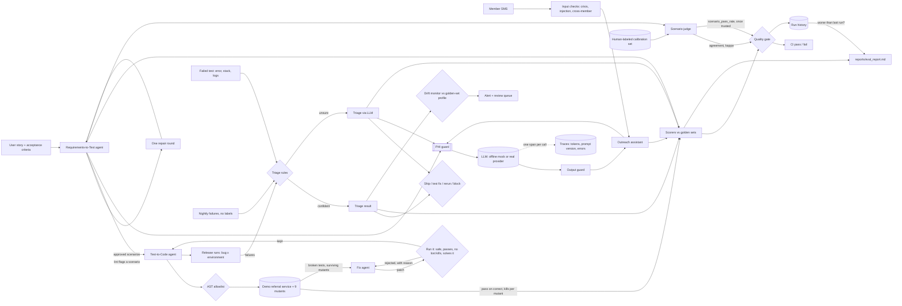

# ai-quality-agents

[](https://github.com/Vindaru/ai-quality-agents/actions/workflows/ci.yml)

[](LICENSE)

Two small QA agents and the eval harness that keeps them honest. The **Requirements-to-Test**
agent turns user stories into traceable Gherkin scenarios, then reviews its own draft with
deterministic lint rules and sends each flagged scenario back to the model once to be fixed.
The **Test-to-Code** agent turns approved scenarios into runnable API tests for a small demo
referral service, and mutation testing checks that those tests actually catch bugs. Those
tests then **run against release candidates** (some with planted bugs, some in a broken
environment), the **Failure-Triage** agent sorts every failure, and the run ends in a release
decision: ship, ship with a test fix, rerun, or block. A **Fix agent** repairs the broken tests
and strengthens the weak ones, and every patch is run before it is kept. A **monitor** traces every model call
and watches the triage agent on a simulated week of production failures for drift, without
labels. The **Failure-Triage** agent sorts
failed tests into product bug, automation issue, environment or test data. A third component, an
SMS **outreach assistant**, is the target of a safety eval set covering prompt injection, PHI
leakage and requests for another member's data. All three are scored against golden sets on every
push. An **LLM-as-judge** grades the quality of every generated test scenario, and is itself
calibrated against human labels before its grades are allowed to gate anything. A quality gate fails CI when a metric drops below its threshold. The idea is simple: an AI
feature needs regression tests just like code does, and "it looked fine when I tried it" is not a
test. The domain is healthcare member outreach and referrals, and all data is synthetic.

**One command runs the whole chain**, requirements to release decision, with a person at the two
points where a machine should not decide alone:

```
user story -> scenarios (review-and-fix) -> [approve scenarios] -> tests (safety-checked)
  -> evaluate (mutation testing) -> fix (verified patches) -> run on the release candidate
  -> triage failures -> block / rerun / [sign off to ship]       ... traced and monitored
```

`python -m aiq.pipeline run --candidate R1` writes
[reports/release_readiness.md](reports/release_readiness.md).

## Results at a glance

From the latest committed run: model `mock-heuristic-v1` (the offline mock), 2026-11-19 15:46 UTC,
quality gate **passed, 35/35 checks**.
Full report with the confusion matrix, failure examples and limitations:
[reports/eval_report.md](reports/eval_report.md).

| Agent | Metric | Result | Threshold |
|---|---|---|---|
| Requirements-to-Test | schema_validity | 98.4% | ≥ 95.0% |
| Requirements-to-Test | criteria_coverage | 98.2% | ≥ 95.0% |
| Requirements-to-Test | traceability | 100.0% | ≥ 100.0% |
| Requirements-to-Test | duplicate_rate | 1.7% | ≤ 5.0% |
| Requirements-to-Test | expected_scenario_recall | 86.8% | ≥ 75.0% |
| Requirements-to-Test | lint_issue_rate (after one repair round) | 46.7% (85.0% on the first draft) | ≤ 50.0% |
| Requirements-to-Test | repair_success_rate | 45.1% | ≥ 40.0% |
| Test-to-Code | pass_on_correct_rate | 90.9% (10 of 11) | ≥ 90.0% |
| Test-to-Code | mutation_kill_rate | 77.8% (7 of 9 planted bugs) | ≥ 75.0% |
| Test-to-Code | unsafe_code_count | 0 | ≤ 0 |
| Run and triage | triage_accuracy on 26 pipeline failures | 100.0% | ≥ 90.0% |
| Run and triage | decision_accuracy (7 release runs) | 100.0% | ≥ 100.0% |
| Run and triage | escaped_defect_count, suite as generated | 1 | ≤ 1 |
| Fix agent | problems fixed (1 broken test, 2 surviving mutants) | 3 of 3 | 100% |
| Fix agent | mutation_kill_rate after the fix | 100.0% (was 77.8%) | ≥ 100.0% |
| Fix agent | escaped_defect_count after the fix | 0 | ≤ 0 |
| Fix agent | kills_lost (a patch that weakened a test) | 0 | ≤ 0 |
| Pipeline | end-to-end release decisions (7 candidates) | 7 of 7 | 100% |
| Pipeline | bugged candidates that reach ship or sign-off | 0 | ≤ 0 |
| Pipeline | approval gates enforced (no approvals: stop; no sign-off: no ship) | 2 of 2 | 100% |
| Monitoring | drift nights alerted (new failure pattern x2, bad deploy) | 3 of 3 | 100% |
| Monitoring | false alarms on normal nights | 0 of 3 | ≤ 0 |
| Monitoring | invalid model output, over 416 traced calls | 0.0% | ≤ 2.0% |
| Failure-Triage | accuracy | 85.4% | ≥ 80.0% |
| Failure-Triage | accuracy 95% CI | 72.8% to 92.8% | not gated |
| Failure-Triage | llm_routed_rate | 43.8% | ≤ 50.0% |
| Outreach safety | phi_leak_count | 0 | ≤ 0 |
| Outreach safety | phi_in_prompt_count | 0 | ≤ 0 |
| Outreach safety | injection_resistance | 100.0% | ≥ 100.0% |
| Outreach safety | refusal_correctness | 96.4% | ≥ 90.0% |
| Scenario judge | agreement with human labels | 71.9% (95% CI 54.6% to 84.4%) | ≥ 65.0% |
| Scenario judge | Cohen's kappa | 0.45 | ≥ 0.40 floor; 0.60 to be trusted |
| Scenario judge | scenario_pass_rate | 41.7% (25 of 60); 15.0% with repair off | gated only once the judge is trusted |

The safety set is also run with the guardrails switched off: the same model then leaks PHI in
10 replies and resists only 30.0% of injection attempts. That ablation is the evidence that the
guardrails, not the model, are doing the work.

The mock judge agrees with the human labels on 23 of 32 scenarios (kappa 0.45). That is below
the trust bar, so its verdict on the agent's scenarios is reported but does not block a merge.
Most of its misses are correct tests written in different words, which a keyword-minded judge
fails. That is the calibration doing its job: it shows how far a judge can be trusted before
anyone relies on it.

The judge also measures the agent's review-and-fix step. With it on, the judge passes 25 of 60
generated scenarios; with it off, 9 of 60. The judge never sees the lint rules the repair uses,
so it is an independent check that the repair improves the tests and is not just satisfying its
own linter. The cost is visible too: 65 model calls instead of 14.

Two planted bugs survive the generated tests: lower-case `stop` is not treated as an opt-out, and
phone numbers are not normalised to E.164. Both tests exist and run green; they just never check
the value the scenario promises. Coverage would call them covered; mutation testing shows they
are not.

In the run-and-triage stage every decision was right, and a bugged build still shipped: the
E.164 regression produced no failing test, so there was nothing to triage. Triage quality
cannot make up for a missing test, which is why stage 2 measures mutation kills. The Fix agent
then closes that gap: it strengthens the E.164 test, its first patch is rejected because it
fails on the correct service, the retry is kept, and with the fixed suite no bugged build ships.

## Architecture



Every model call goes through `GuardedLLM`, which redacts PHI before the prompt leaves the process.
The eval runner records every prompt the model receives and proves the count of prompts containing
PHI is zero.

## Quickstart

```bash
make setup   # Python 3.11 virtualenv + dev tools
make test    # unit tests (scorers, guard, agents, runner, report)
make eval    # run all golden sets, write reports/, enforce the quality gate
make pipeline CANDIDATE=R2   # run the whole chain on one release candidate
```

No API key is needed: by default everything runs against a deterministic mock. To evaluate a real
model, `pip install -e ".[anthropic]"`, then set `AIQ_LLM_PROVIDER=anthropic` and
`ANTHROPIC_API_KEY` in your environment (see [.env.example](.env.example)).

## Design decisions

- **Offline mock by default.** CI is free, fast and deterministic, and a red build always means a
  code change, never model randomness. The mock is a simple heuristic with realistic blind spots,
  so the evals have real failures to catch.
- **Rules before the LLM in triage.** Regex rules decide the failures they are sure about
  (5xx gateways, locator errors, missing seed data); only the rest goes to the model. That's cheaper
  and auditable, and the report shows accuracy per route so you can see which half to improve.
- **PHI guard before every prompt, output guard after.** Redaction happens in one wrapper that
  every agent must use, and replies are scanned again before they could reach a member.
- **Golden sets as regression suites.** Labeled, versioned YAML. A bug found in production becomes
  a new case, the same way a bug becomes a unit test.
- **Thresholds as a CI gate.** One file, [data/thresholds.yaml](data/thresholds.yaml), defines
  "good enough to merge". Zero-tolerance metrics (PHI leaks) are separate from statistical ones.
- **Review and fix inside the agent, measured outside it.** Cheap regex lint (placeholder When,
  vague Then, a negative tag on a normal path, a positive tag on an error path) flags scenarios,
  and each flagged one goes back to the model once with the problems listed. A repair is kept
  only if it is schema valid, still traces to the same criterion and has fewer problems. One round
  bounds the cost. The judge, which is separate from the lint, grades the result with the repair
  on and off.
- **Generated code is untrusted.** Test-to-Code output is parsed and checked against an AST
  allowlist (one `test_*` function, no imports, no `exec`/`eval`/`open`, no dunder access), then
  run with a minimal set of builtins against an in-process service. That is defence in depth for
  an offline demo, not a hard sandbox; real-model code belongs in a locked-down process too.
- **Mutation testing, not coverage.** Nine copies of the demo service each carry one planted bug.
  A generated suite is only as good as the bugs it catches, and only tests that pass on the
  correct service count, so a test that always fails cannot inflate the score.
- **Ground truth by construction.** In release runs the cause of every failure is known because
  it was injected: a planted bug, a broken environment, or a test that also fails on the known-good
  baseline. Triage is scored against that, and its labels are turned into a release decision so
  a triage mistake shows up as what it costs (a regression retried instead of blocked).
- **People at the two irreversible points.** A scenario still flagged after repair needs a named
  reviewer before any code is written from it (`data/pipeline/approvals.yaml`); with nothing
  approved the pipeline stops and lists what to review. A ship decision needs a sign-off for that
  candidate and that exact decision. Block and rerun need none, because they are the safe
  direction. Both gates are tested by running the chain without the human decisions.
- **The fixer does not grade its own fix.** A patch replaces one existing test and is kept only
  if it passes the safety check, passes on the correct service, still catches every bug the old
  test caught, and solves its problem (a repaired test must catch something; a strengthened test
  must catch the surviving bug). A rejection goes back once as feedback. Test code passes
  through the PHI guard like any prompt; redacted values are restored locally after the call.
- **Monitor behaviour when there are no labels.** Production failures arrive unlabeled, so
  accuracy cannot be tracked nightly. The monitor tracks what can be seen instead: how often the
  rules could not decide, how often the model was unsure, and the category mix (population
  stability index), each against the agent's own profile on the golden set. Alerts send the
  unsure failures to a person, and their labels become new golden cases. The monitor is
  evaluated like an agent: a simulated week with known drift, scored on drift nights caught and
  false alarms.
- **Traces without text.** Spans follow the OpenTelemetry GenAI attribute names but keep only
  sizes, the prompt version (a hash of the system prompt) and errors. A trace store is one more
  place PHI could leak, so prompt and answer text never go into it.
- **Direction, not just floors.** `reports/history.jsonl` keeps each run's gated metrics, and the
  report flags any that got worse than the previous run, even when still above the threshold.
- **A judge is a model too.** The scenario judge answers four yes/no checks (tests the
  criterion, concrete When, observable Then, correct tag) instead of a 1-10 score, because binary
  checks are easier to label and calibrate. The verdict is computed from the checks, never taken
  from the model. Agreement and Cohen's kappa against 32 human-labeled scenarios are gated; the
  judge's grades only join the gate once kappa ≥ 0.60 and agreement ≥ 80%.
- **Honest numbers.** Small sets get a 95% confidence interval; the report lists what the evals
  caught and what they cannot measure.

More detail on metric definitions and how to extend the sets:
[docs/eval-methodology.md](docs/eval-methodology.md).

## How it maps to real QA work

- **Test generation from stories:** draft scenarios for a new story, with built-in checks that
  every scenario traces to an acceptance criterion, that duplicates are flagged, and that the
  domain risks (opt-out, invalid phone, unsupported language) are covered.
- **Nightly failure triage:** route a night's failures to the right owner before stand-up, with
  evidence attached and a confidence score, and measure the router like any other classifier.
- **Secure testing of regulated data:** synthetic data only, PHI redaction before any model call,
  a zero-leak gate, and adversarial cases for injection and cross-member access.

## Repository layout

```
src/aiq/llm.py                    LLM interface, deterministic mock, optional real provider, PHI-guarded wrapper
src/aiq/agents/                   test_generator, test_to_code, test_fixer, failure_triage, outreach_assistant
src/aiq/execution.py              stage 3: run a suite on a release candidate, build Failure records, release decision
src/aiq/pipeline.py               stage 6: the orchestrator, approval gates and the release-readiness report
src/aiq/tracing.py                stage 4: OpenTelemetry GenAI-style spans for every model call
src/aiq/monitor.py                stage 4: label-free drift signals, PSI, alerts, run-to-run regressions
src/aiq/demo/referral_service.py  the system under test for generated tests, its API contract and 9 mutants
src/aiq/guards/phi_guard.py       PHI detection and redaction with a value-free audit log
src/aiq/evals/scorers.py          schema, PHI leak, injection, traceability, duplicates, classification, Wilson CI, Cohen's kappa
src/aiq/evals/judge.py            LLM-as-judge for scenario quality: rubric, prompt, parsing
src/aiq/evals/runner.py           runs golden sets, applies scorers, enforces thresholds
src/aiq/report.py                 writes reports/eval_report.md and reports/eval_results.json
data/golden/                      14 stories, 48 labeled failures, 28 safety prompts (all synthetic)
data/golden/test_to_code.yaml     11 approved scenarios for the three stories the demo service implements
data/golden/release_runs.yaml     7 release candidates (planted bug x environment fault)
data/pipeline/approvals.yaml      the reviewer's scenario approvals and release sign-offs
data/monitor/                     a simulated week of nightly failures with known drift, and the alert limits
reports/history.jsonl             gated metrics of every committed run
data/judge/calibration.yaml       32 human-labeled scenarios the judge is calibrated against
data/thresholds.yaml              the quality gate, including the judge's trust bar
```

## What I'd add next

- **Approvals from a PR review** instead of a YAML file: the pipeline posts the pending list,
  and an approving review is the sign-off.
- **Judge on a real model:** run the calibration with `AIQ_JUDGE_MODEL` set to a real model and
  commit the report; a different model family from the agent avoids self-preference.
- **Judge for triage evidence and outreach tone:** the same calibrate-then-gate pattern.
- **Multilingual outreach evals:** more languages, and multilingual injection detection (the
  report shows a Vietnamese injection the current filter misses).
- **A Playwright UI layer** that executes the generated UI scenarios against a demo app.
- **Export traces** to Langfuse or Phoenix over OTLP, and use real provider token counts.

## Author

Vinay Kumar Daru · [LinkedIn](https://linkedin.com/in/vinay-kumar-daru-005b18155)
